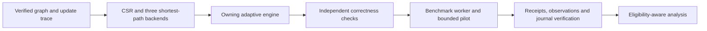

# DynaGraph-HPC

DynaGraph-HPC is a C++17/OpenMP research software project for exact single-source
shortest paths on directed graphs whose weights change between queries. It combines
reference Dijkstra, parallel delta-stepping and transactional sequential repair
behind an owning adaptive engine, with deterministic workloads and verifiable
benchmark evidence. The emphasis is correctness, traceability and reproducibility.

**Verified software is not a verified speedup.** Phases A–E are accepted within
their documented local scopes. The original 104-trial campaign remains unexecuted;
two derived Phase D trials are verified diagnostic executions, both
`observed_interference`, with zero scientifically eligible timing observations.
Performance statistics, confidence intervals and multicore speedup are unavailable.
TSan acceptance remains unmet. See [current documentation acceptance](docs/phase-f-acceptance.md).

## Capabilities and boundaries

- Owning CSR with fixed vertices/topology, stable edge IDs, uint32 nonnegative
  weights and uint64 distances; unreachable CLI distances are JSON null.
- Lazy-heap Dijkstra and OpenMP delta-stepping with a persistent team, atomic
  relaxation and explicit bucket synchronization.
- Sequential, transactional single-edge decrease repair; recoverable exceptions
  preserve graph/distances/caller metrics. Storage/full recomputation can support
  weight increases; incremental increases and topology changes are deferred.
- Forced policies and a deterministic metadata heuristic over one authoritative
  state. Fixed thresholds are hypotheses, not learned or calibrated crossover points.
- Canonical graph/update generation, independent oracles, separate verification/
  timing workers, bounded opt-in diagnostic pilots, conservative GO receipts,
  workload/resource evidence, immutable journals and explicit safe resume.
- Read-only verified diagnostic analysis, accounting figures and synthetic-tested
  numerical methods that do not grant scientific timing admission.

All updates occur between completed queries. Every access to a shared adaptive
engine needs external serialization. Parallel repair, concurrent mutation, batch
updates, learned selection and automatic delta tuning are not implemented.

## Architecture



C++ graph/algorithms, CLI, benchmark replay and instrumentation are separate modules.
Python handles generation, orchestration, evidence verification and analysis. The
[architecture reference](docs/architecture.md) explains APIs, data flow, synchronization,
transaction guarantees and justified complexity bounds.

## Build and quick start

Run in `/workspaces/Dynagraph-HPC` in the existing Codespace. Needs GCC/OpenMP,
CMake >=3.21, Make, Python and the existing exact-pinned `.venv-analysis` for this
full configuration. No dependencies are installed by these commands. If the venv
is missing, follow the [prerequisite gate](docs/reproducibility-guide.md#preconditions-and-opening-the-workspace)
and request installation permission; do not silently weaken full validation.
Choose new build/data output paths if these names already exist.

```sh
cmake -S . -B build/review -G 'Unix Makefiles' \
  -DCMAKE_BUILD_TYPE=Release -DDYNAGRAPH_WARNINGS_AS_ERRORS=ON \
  -DDYNAGRAPH_FULL_VALIDATION=ON \
  -DDYNAGRAPH_ANALYSIS_PYTHON="$PWD/.venv-analysis/bin/python"
cmake --build build/review --parallel 2
ctest --test-dir build/review --output-on-failure --parallel 1
.venv-analysis/bin/python -B benchmarks/python/generate.py generate \
  --spec benchmarks/configs/chain-v1.json --output data/review-chain
.venv-analysis/bin/python -B benchmarks/python/generate.py verify \
  --manifest data/review-chain/manifest.json
build/review/dynagraph_cli sssp --input data/review-chain/graph.txt \
  --source 0 --algorithm dijkstra
build/review/dynagraph_cli sssp --input data/review-chain/graph.txt \
  --source 0 --algorithm delta-stepping --delta 16 --threads 2
build/review/dynagraph_bench verify --graph data/review-chain/graph.txt \
  --trace data/review-chain/trace.txt --source 0 --policy incremental \
  --delta 16 --threads 2 --no-effect shared_fast_path --verification full
```

Expect 31 full default CTests, matching static distance vectors, and successful
full per-update repair verification. Worker requests are not actual team guarantees.
`dynagraph_cli --help` and `dynagraph_bench --help` are the authoritative interfaces;
there is no incremental static-CLI subcommand. The library-only build can use
`-DBUILD_TESTING=OFF` without full-validation options and needs no Python. Debug/
Release presets also exist; the full [reproduction guide](docs/reproducibility-guide.md)
provides the environment gate, optional 33-test diagnostics, repair failure tests,
Python regressions and exact commands validated for the demonstration.

## Benchmark, evidence and analysis workflow

1. Generate and recipe/hash-verify canonical inputs before C++ replay.
2. Validate/expand the original plan without modifying its definitions. Its 104
   rows are planning, not completed experiments; placeholder build hashes are not
   executable provenance. The canonical hashes are in [Phase D acceptance](docs/phase-d-acceptance.md).
3. With explicit authorization, stage a **new derived development plan** and select
   bounded diagnostics through the existing pilot/enforcement pipeline. Limits are
   eight trials, 120 s wall and 30 s per trial. Never split the matrix to bypass them.
4. Reverify raw receipts, oracles, workload/resource semantics and journal lifecycle.
   A successful integrity check of failed evidence is not successful execution.
5. Analyze only verified inputs under their actual eligibility. Phase E's historical
   adapter needs the original retained Phase D directory and explicit inventory
   anchor; it cannot relabel a new pilot as the historical one.

The [end-to-end guide](docs/reproducibility-guide.md) covers fresh diagnostic execution,
archive verification and the exact Phase E analysis command. Ignored historical
artifacts are not part of a clean clone: the guide checks availability and identity
before using them. A clean build can reproduce algorithm checks and a fresh
permitted fixture; historical findings require their original retained bytes.
The [professor demo](docs/professor-demo.md) provides prepared five- and ten-minute
walkthroughs, command readiness checks, expected observations and technical Q&A.

## Verification and scientific limitations

Correctness uses independent hand/seeded Bellman–Ford oracles, complete-state
comparisons against recomputation, transaction/failure and concurrency controls.
Accepted Phase E checks include Debug/Release/ASan+UBSan+LeakSanitizer 31/31 each,
382 campaign tests, additive native diagnostics, rendering/registration/smoke and
independent current/historical archive verification. [Phase F acceptance](docs/phase-f-acceptance.md)
distinguishes newly executed documentation checks from retained validation evidence.
No hosted-CI result is inferred from local execution.

Codespaces affinity, logical CPUs and snapshots do not establish exclusive
physical cores, stable isolation or absence of interference. The accepted Phase D
visible CPUs are SMT siblings on one core; both diagnostic trials observed shared
CPU pressure. No scientifically admissible timing data, performance inference,
publishable multicore speedup or race-freedom conclusion exists. The work_ TSan
report remains classified LIKELY TOOL/RUNTIME LIMITATION, not race freedom.
Numerical bootstrap tests do not establish independence or performance evidence.

## Documentation index

| Topic | Reference |
| --- | --- |
| Architecture, algorithms, data ownership and synchronization | [Architecture](docs/architecture.md) |
| Codespaces setup through verified reports | [Reproduction guide](docs/reproducibility-guide.md) |
| Five-/ten-minute presentation and Q&A | [Professor demo](docs/professor-demo.md) |
| Questions, workload/timing methodology and scientific gates | [Experimental protocol](docs/experimental-protocol.md) |
| Generation / correctness replay / timing boundaries | [Artifacts](docs/workload-artifacts.md), [replay](docs/benchmark-replay.md), [timing](docs/benchmark-timing.md) |
| Plans / bounded pilots / journal and explicit resume | [Foundation](docs/campaign-foundation.md), [pilot](docs/campaign-pilot.md), [recovery](docs/campaign-recovery.md) |
| GO/affinity / actual workload teams / shared counters | [Enforcement](docs/resource-enforcement.md), [workload](docs/workload-instrumentation.md), [interference](docs/resource-interference.md) |
| Numerical methods, verified analysis and limitations | [Analysis](docs/benchmark-analysis.md), [Phase E](docs/phase-e-acceptance.md) |
| Full test gates, portable archives and historical recovery | [Validation runbook](docs/reproducibility-validation.md), [Phase A](docs/phase-a-acceptance.md) |
| Accepted local phase matrices | [A](docs/phase-a-acceptance.md), [B](docs/phase-b-acceptance.md), [C](docs/phase-c-acceptance.md), [D](docs/phase-d-acceptance.md), [E](docs/phase-e-acceptance.md), [F](docs/phase-f-acceptance.md) |
| Provenance of changes, failures and bounded findings | [Research log](docs/research-log.md) |
